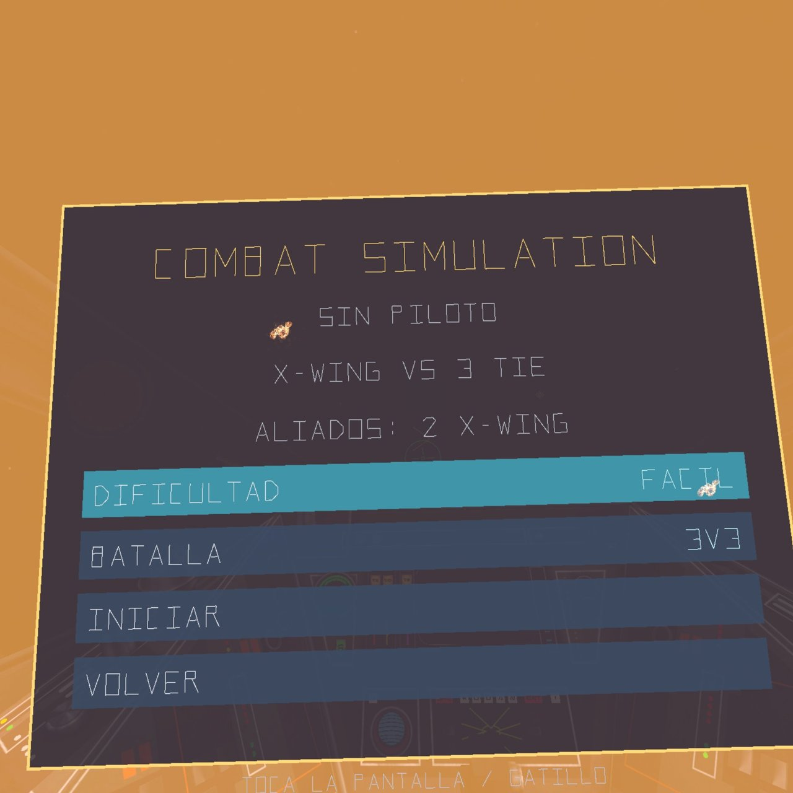
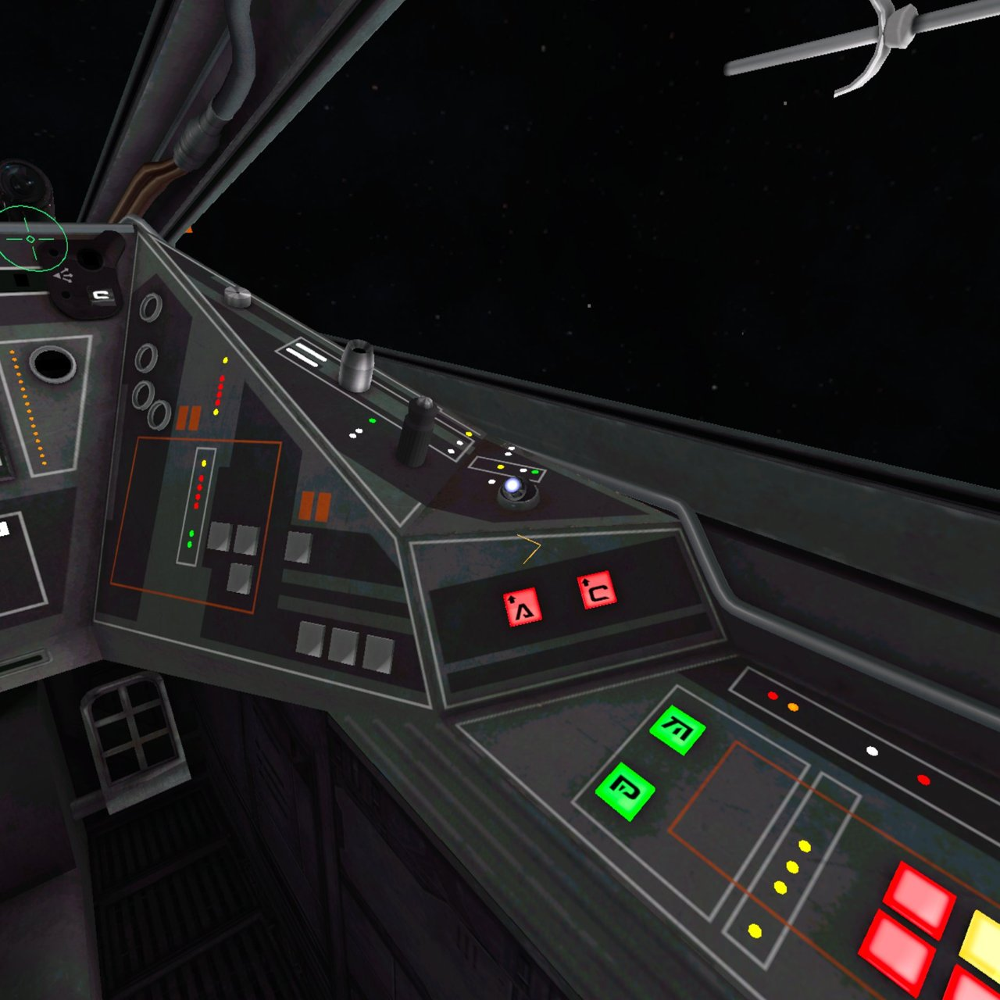
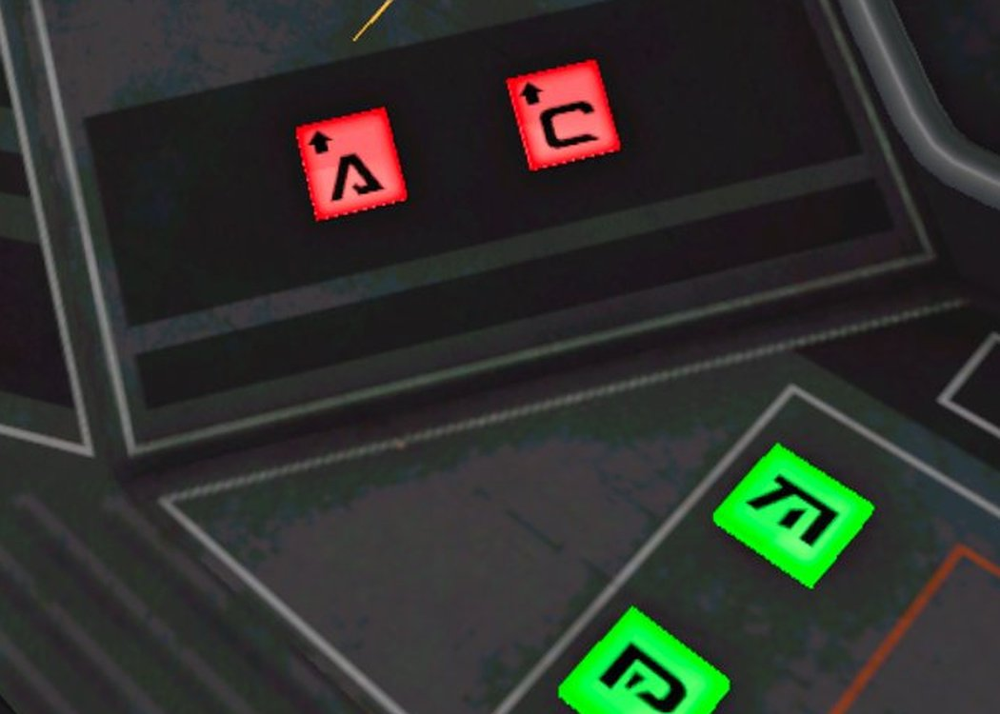

# XWADuelVR

Duelo X-Wing vs TIE en realidad virtual standalone para Meta Quest:
tú contra oleadas TIE desde el cockpit, con menú tablet que puedes
agarrar con las manos, rondas configurables y botón físico de pausa
en la consola derecha. Basado en OpenXWA (Android ARM64, SDL
GPU/Vulkan, OpenXR). **No requiere streaming desde un PC.**

> Proyecto experimental de fans, en pruebas de usuario (UAT).
> Estado revisado el **11 de octubre de 2026**.

*Menú principal capturado en el visor: dificultad, batalla, rondas.*

*El par de botones rojos A/C junto a la ventana derecha; la A pausa.*

*Acercamiento: botón A (izquierda, pausa) y botón C (derecha).*

## Estado actual (M26-TXT, `3.30-M26-txt`)

- **Combate:** X-Wing del jugador + 2 aliados vs oleadas TIE, rondas
  1/3/5 (por defecto 3), línea de resultado por ronda.
- **Manos:** palanca de mando y cuadrante de acelerador con agarre de
  puño/pellizco; gatillo con el pulgar; sin cuerpo de piloto.
- **Menú tablet:** se toca con el dedo, se agarra de los lados con
  pellizco, sigue a la mano (tableta en mano), escala x0.42.
- **Pausa:** botón rojo físico "A" de la consola derecha pausa el
  juego y trae el menú; etiqueta PAUSA ámbar/blanca/verde.
- **Probado en:** Quest del autor con seguimiento de manos y mandos
  Touch. Sin validación en otros visores.

## UAT: pedimos tu prueba

Hay una APK lista en
[**Releases**](https://github.com/enacianceno/XWADuelVR/releases).
Si tienes un Quest 3/3S con modo desarrollador:

1. Instala sin desinstalar la anterior:
   `adb install -r XWADuelVR-M26-TXT-debug.apk`
   (paquete `org.openxwa.xwaduellvr`).
2. Sigue el plan de prueba en [docs/UAT.md](docs/UAT.md):
   menú, tablet, combate, rondas, botón de pausa, recentrado.
3. Reporta con la plantilla de [docs/UAT.md](docs/UAT.md):
   visor, build, pasos, esperado vs observado, foto o video.

## Limitaciones conocidas

Controles, interfaz y VR siguen incompletos. Proyecto en desarrollo
activo: no se garantiza rendimiento, estabilidad ni compatibilidad
con todos los visores. Usa headset straps ajustados y espacio libre;
si algo se siente mal, quítate el visor y reporta.

## Compilación

- Nativo: `.\Build-Target.ps1` (CMake + NDK, `arm64-v8a`).
- APK: Gradle `assembleDebug`
  (`app/build/outputs/apk/debug/app-debug.apk`).
- Suites: `python tests/test_render_rules.py` y el binario
  `tests/test_duel.c` compilado para Android y corrido en el visor.
  El código local puede ir por delante de lo publicado aquí.

## Disclaimer

XWADuelVR es un proyecto experimental e independiente, sin afiliación
ni respaldo oficial de los titulares de X-Wing Alliance / Star Wars
(Lucasfilm/Disney) ni de Meta. Es un trabajo de fans, sin fines de
lucro: no incluye ni distribuye datos originales del juego y no vende
contenido de terceros. Úsalo bajo tu propio riesgo.

XWADuelVR is an independent experimental fan project with no official
affiliation or endorsement from the X-Wing Alliance / Star Wars rights
holders (Lucasfilm/Disney) or Meta. It is non-commercial: it does not
bundle or distribute original game data and sells no third-party
content. Use at your own risk.

## Apoya el desarrollo / Support development

[Apoyar mediante Mercado Pago](https://link.mercadopago.com.mx/xwaquest)

Las aportaciones son voluntarias y ayudan a cubrir herramientas de
programación e IA, pruebas y otros gastos de desarrollo. No compran el
juego, sus archivos ni contenido de terceros, y no garantizan funciones
o fechas de entrega.

Voluntary contributions help cover programming and AI tools, testing
and other development expenses. They do not purchase the game, game
assets or third-party content, and do not guarantee features or
delivery dates.
